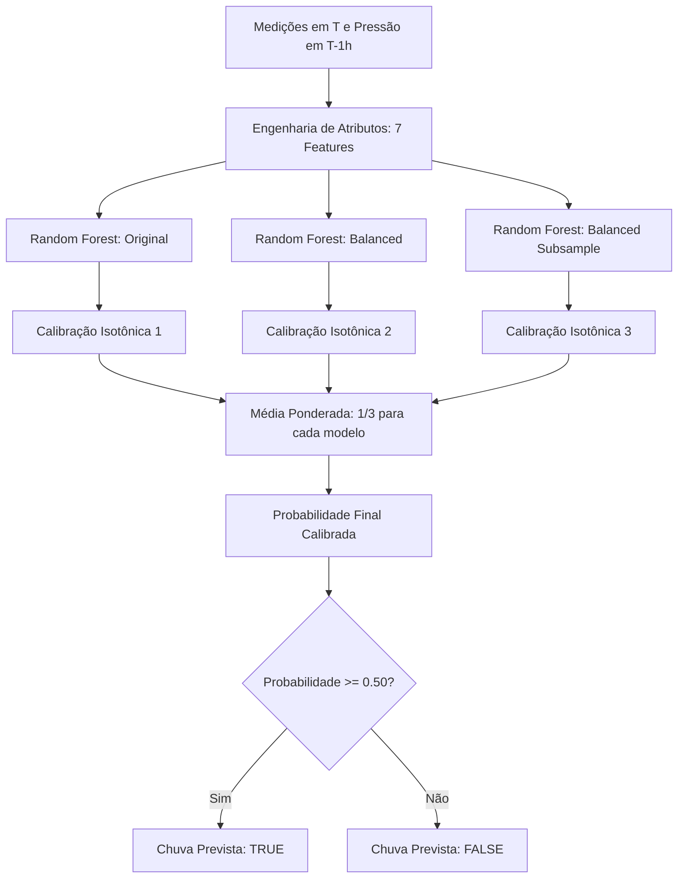

# Módulo de Modelagem Preditiva e Inteligência Artificial

**Previsão de Chuva em Curto Prazo — Londrina/PR**

Este repositório contém o pipeline de engenharia de dados, treinamento, validação temporal, calibração probabilística e empacotamento do modelo preditivo de Machine Learning para detecção de chuva horária ($T+1h$).

---

## 1. Visão Geral do Sistema

* **Problema:** A estimativa de chuva em curto prazo a partir de medições de superfície apresenta forte desbalanceamento de classes (ocorrência histórica em menos de 10% a 17% dos registros horários).
* **Objetivo:** A partir de observações atmosféricas locais na hora de referência ($T$) e na hora anterior ($T-1h$), calcular a probabilidade calibrada de precipitação acumulada na hora seguinte ($T+1h$).
* **Entrega:** O pacote serializado `weather_ensemble.joblib` e o manifesto `manifest.json`, integrados aos serviços da API para disponibilização das previsões.

---

## 2. Arquitetura do Modelo

O modelo preditivo adota um **Ensemble Calibrado de Média Simples**, combinando três famílias de Random Forest com 400 árvores e folha mínima 10:

1. **`original`**: Ajustado na distribuição natural das classes (`class_weight=None`), priorizando alta precisão e baixa taxa de alarmes falsos.
2. **`balanced`**: Ajustado com pesos inversamente proporcionais às frequências de classe (`class_weight='balanced'`), aumentando a sensibilidade na detecção de eventos raros.
3. **`balanced_subsample`**: Pesos balanceados recalculados dinamicamente em cada partição de bootstrap (`class_weight='balanced_subsample'`).



### Contrato de Variáveis (7 Features)
* **Entradas Brutas (instantes $T$ e $T-1h$):**
  * `temperature_2m` (Temperatura do ar a 2m)
  * `relative_humidity_2m` (Umidade relativa do ar a 2m)
  * `pressure_msl` (Pressão atmosférica ao nível do mar no instante $T$)
  * `cloud_cover` (Cobertura total de nuvens)
  * `pressure_msl_previous_hour` (Pressão atmosférica no instante anterior $T-1h$)
* **Variáveis Derivadas:**
  * `temp_humidity`: Interação térmica e higrométrica ($Temperatura \times Umidade$).
  * `pressure_diff`: Tendência barométrica horária ($Pressão(T) - Pressão(T-1h)$).
  * `hour_of_day`: Ciclo diurno local (0 a 23h no fuso `America/Sao_Paulo`).

---

## 3. Estrutura de Diretórios

O repositório está organizado para manter apenas os módulos ativos do pipeline de produção:

```text
.
├── config.py                               # Configurações de caminhos e fuso horário
├── requirements.txt                         # Dependências do ambiente Python
├── README.md                                # Documentação técnica do pipeline
│
├── scripts/                                # Scripts executáveis do pipeline
│   ├── prepare_weather.py                  # Formatação da base histórica e definição do alvo T+1h
│   ├── train_v6.py                         # Validação cruzada rolling-year, treino dos 3 RFs e ensemble
│   ├── evaluate_test.py                    # Avaliação aninhada v7, calibração e análise de custos
│   ├── package_weather_model.py            # Empacotamento do modelo final em .joblib e manifest.json
│   └── check_staged.py                     # Hook de validação do repositório Git
│
├── src/
│   └── models/
│       ├── __init__.py
│       └── weather_ensemble.py             # Classe SimpleMeanCalibratedEnsemble (inferência e features)
│
├── reports/
│   └── training/
│       ├── sixth_training_report.md        # Relatório de validação e métricas do treino v6
│       └── seventh_training_report.md      # Relatório de calibração isotônica e custos v7
│
├── tests/                                  # Suíte de testes unitários
│   ├── test_onboarding.py                  # Teste de conformidade de arquivos
│   ├── test_prepare_weather.py             # Teste de formatação e integridade dos dados
│   └── test_train.py                       # Teste do ensemble, features e treinamento
│
└── docs/                                   # Documentação técnica
    ├── prepare_weather.md                  # Especificação das regras de tratamento da base
    └── legacy/                             # Histórico técnico e relatórios anteriores arquivados
```

---

## 4. Requisitos e Instalação

* **Python:** 3.13+
* **Git**

```bash
# 1. Clonar o repositório
git clone https://github.com/victorhukra/backend-monitoramento-ambiental.git
cd backend-monitoramento-ambiental

# 2. Criar e ativar o ambiente virtual
python -m venv .venv
# Windows:
.\.venv\Scripts\Activate.ps1
# Linux/macOS:
source .venv/bin/activate

# 3. Instalar dependências
pip install -r requirements.txt

# 4. Configurar arquivo de ambiente
cp .env.example .env
```

---

## 5. Execução do Pipeline

### Passo 1: Preparação da Base
Valida o domínio físico das medições meteorológicas, localiza os timestamps no fuso `America/Sao_Paulo` e cria o dataset com o alvo `rain_next_hour`:

```bash
python scripts/prepare_weather.py
```
*Arquivo gerado:* `data/processed/weather_training.csv`

### Passo 2: Treinamento e Validação Cruzada (v6)
Aplica validação cruzada temporal em janela expansiva (*rolling-year* de 2022 a 2025) com 3 sementes aleatórias para comparar as estratégias e ajustar os modelos finais:

```bash
python scripts/train_v6.py
```
*Saídas geradas:* Métricas por partição/semente, previsões fora da amostra (OOF), modelos `.joblib` congelados e o relatório `reports/training/sixth_training_report.md`.

### Passo 3: Avaliação de Calibração e Limiares Operacionais (v7)
Avalia calibração não-paramétrica (Isotônica) e simulações de matriz de custo entre Falsos Positivos e Falsos Negativos:

```bash
python scripts/evaluate_test.py
```
*Saídas geradas:* Matriz de complementaridade de erros, resumo de custos operacionais e `reports/training/seventh_training_report.md`.

### Passo 4: Empacotamento do Modelo
Ajusta os calibradores isotônicos com as previsões OOF, valida a paridade da engenharia de features e serializa o artefato consumido pela API:

```bash
python scripts/package_weather_model.py
```
*Saídas geradas:* `weather_ensemble.joblib` e `manifest.json`.

---

## 6. Testes Automatizados

Para executar a suíte de testes unitários:

```bash
python -m unittest discover tests
```

---

## 7. Integração com a API

O pacote serializado (`weather_ensemble.joblib` e `manifest.json`) é consumido pelo backend Flask da aplicação integrada (`projeto-monitoramento-ambiental`):

* A classe `SimpleMeanCalibratedEnsemble` (`src/models/weather_ensemble.py`) é carregada na inicialização do serviço pelo módulo `model_service.py`.
* O `model_service.py` valida o hash SHA-256 do arquivo e a ordem das 7 features contra o `manifest.json`.
* A cada requisição HTTP em `POST /predict`, os dados meteorológicos em $T$ e $T-1h$ são consultados no banco pelo `weather_service.py` e repassados ao método `predict_one(...)`.
